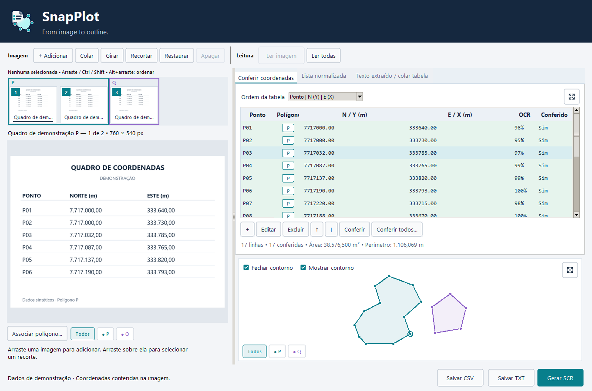

<p align="center">
  
</p>

<h1 align="center">SnapPlot</h1>
<p align="center"><strong>From image to outline.</strong></p>
<p align="center">Leia coordenadas em imagens, confira os pontos e prepare contornos para o AutoCAD.</p>

O SnapPlot é um aplicativo para Windows que transforma quadros de coordenadas e memoriais em uma tabela editável, listas de pontos e contornos. O reconhecimento de texto acontece no próprio computador.



*Interface do aplicativo no Windows, com imagens e coordenadas sintéticas de demonstração.*

## Da imagem ao desenho

1. Use **Adicionar** para abrir imagens ou uma lista TXT. Também é possível arrastar arquivos para a janela ou colar imagens com **Ctrl+V**.
2. Selecione as miniaturas e clique em **Ler imagem** ou **Ler selecionadas**. Use **Ler todas** para processar a fila inteira.
3. Confirme o tipo de leitura, a ordem dos eixos e o formato dos números da imagem original.
4. Compare a tabela com a imagem, edite os pontos necessários e marque os valores como conferidos.
5. Confira os contornos e exporte a lista de coordenadas ou o script para o AutoCAD.

## Conferência dos pontos

- Consulte a tabela, a **Lista normalizada** e o **Texto extraído** sem perder a imagem de origem.
- Amplie a conferência para exibir a imagem e a tabela lado a lado, mantendo as três abas disponíveis.
- Edite, exclua, insira e reordene pontos. Um novo ponto entra abaixo da linha selecionada ou no final da lista.
- Selecione linhas e imagens por clique, **Ctrl**, **Shift** ou arraste. Clicar fora da área correspondente limpa a seleção.
- Ao selecionar linhas, os pontos correspondentes ficam destacados no contorno.
- Use **Ctrl+C** em uma linha para copiar o par E/X e N/Y. Na edição, **Ctrl+V** pode preencher as duas coordenadas de uma vez.

As linhas conferidas ficam verdes. O vermelho indica problemas que ainda precisam de intervenção, como valores ilegíveis, ambiguidades, duplicidades ou uma geometria inválida. A descrição aparece ao passar o mouse sobre a linha e no formulário de edição.

A falta de conferência, sozinha, não é um erro. Quando o app preenche um identificador ausente, isso fica registrado como informação de origem. A confiança do reconhecimento pode ser consultada na coluna **OCR**.

## Vários polígonos no mesmo projeto

Cada polígono tem uma letra e uma cor próprias. O primeiro usa **P** por padrão; ao criar outros, escolha uma letra diferente.

Você pode associar imagens ou pontos selecionados a um grupo existente, criar outro grupo ou copiar pontos mantendo os originais. Ao mover pontos, o app permite escolher se os pontos restantes da origem devem ser renumerados.

Um novo polígono começa no ponto **01**. Adicionar pontos a um grupo existente continua a sequência desse grupo. Os identificadores são adaptados ao destino quando necessário, mantendo o registro da origem.

Os filtros coloridos permitem comparar os grupos na mesma tabela e visualizar seus contornos juntos, na mesma escala. As miniaturas recebem bordas com a cor do polígono associado.

## Visualização do contorno

Na prévia, confira a forma e os pontos destacados pela seleção da tabela. No modo ampliado, você pode:

- Aproximar ou afastar com a roda do mouse e deslocar a vista arrastando com o botão esquerdo.
- Usar **Ajustar à janela** para reenquadrar os polígonos visíveis.
- Exibir ou ocultar os nomes dos pontos, posicionados fora dos contornos quando há espaço.
- Clicar em um ponto para editar ou excluir, atualizando a tabela.
- Filtrar polígonos pelos controles na parte inferior e consultar a rosa dos ventos fixa.

Área e perímetro são apresentados em **m²** e **m** para coordenadas em metros. Para comparar polígonos, use coordenadas no mesmo sistema de referência e com unidades compatíveis. O app não transforma datum, fuso, projeção ou latitude/longitude.

## Importação e exportação

O TXT usa o formato **Ponto, E/X, N/Y,** com ponto decimal, sem separadores de milhar e com vírgula final:

```text
P01, 333640.0000, 7717000.0000,
P02, 333730.0000, 7717000.0000,
P03, 333785.0000, 7717032.0000,
```

Ao importar um TXT, escolha o polígono de destino. Os nomes do arquivo são adaptados à letra e à sequência desse grupo; as coordenadas e os identificadores de origem são preservados para consulta.

| Formato | Uso |
| --- | --- |
| **TXT** | Lista normalizada de identificadores e coordenadas E/N. |
| **CSV** | Conferência em planilhas, incluindo informações dos pontos e de seus polígonos. |
| **SCR** | Script para desenhar os contornos no AutoCAD. Cada polígono usa uma polilinha independente. |

Quando há vários polígonos, a exportação TXT/SCR permite reunir todos em um arquivo, selecionar quais incluir ou salvar um arquivo por polígono em um ZIP.

No AutoCAD, encerre os comandos ativos e use **SCRIPT** para abrir o SCR. Confira as unidades e o sistema de coordenadas do desenho antes de executar o script.

## Instalação e atualizações

Os instaladores e os arquivos de verificação são disponibilizados exclusivamente na seção **Releases** deste repositório.

A instalação é feita para o usuário do Windows e permite escolher a pasta e criar um atalho na Área de Trabalho. O aplicativo também fica disponível no menu Iniciar e pode ser removido pelas configurações do Windows.

Quando houver uma atualização disponível, o app exibe uma barra de aviso. Ao escolher **Atualizar**, ele guarda a sessão, abre o instalador e fecha para permitir a instalação. A sessão é restaurada na próxima abertura.

## Requisitos e dados locais

- Windows 10 ou 11 de 64 bits, em computador com processador x64.
- Não é necessário instalar Python ou ferramentas de desenvolvimento.
- A leitura de imagens locais funciona sem conexão. A consulta e a obtenção de atualizações usam a internet; importar uma imagem por um endereço da web também usa a rede.
- Para executar scripts SCR, é necessário o AutoCAD ou um aplicativo compatível com esse formato.

As imagens e coordenadas são processadas localmente para o reconhecimento de texto. O OCR pode errar sinais, separadores ou algarismos: compare os resultados com o documento antes de usá-los no desenho.

## Suporte

Para relatar um problema ou sugerir uma melhoria, [abra uma issue](https://github.com/Andre-ARS/SnapPlot_Releases/issues/new).

Informe a versão do aplicativo, a edição do Windows e os passos para reproduzir. Use exemplos sem dados pessoais ou confidenciais ao compartilhar imagens e coordenadas.
