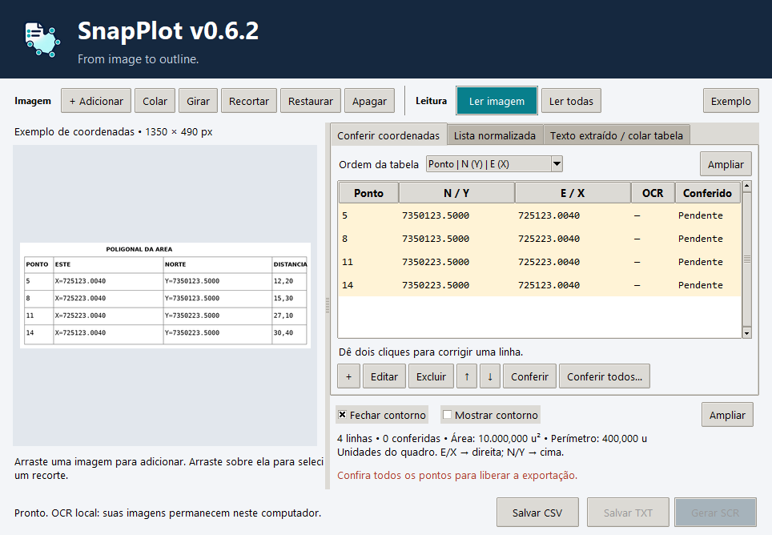

  

<h1 align="center">SnapPlot</h1>

<strong>From image to outline.</strong>

Transforme imagens de quadros de coordenadas e memoriais em uma lista de pontos e um contorno para o AutoCAD.

## Da imagem ao desenho

1. Adicione uma imagem, arraste capturas para a janela ou cole com **Ctrl+V**.
2. Clique em **Ler imagem** e confirme as opções de leitura.
3. Compare os pontos com a imagem e corrija as pendências.
4. Salve a lista **TXT** ou gere o **SCR** para desenhar o contorno no AutoCAD.

*Aplicativo instalado no Windows, usando um quadro sintético de demonstração.*

## O que você pode fazer

- Ler quadros de coordenadas e pares N/E ou X/Y em memoriais.
- Reunir várias imagens na mesma lista, mudar a ordem e selecionar imagens para ler ou apagar.
- Consultar o texto extraído e a lista normalizada, com ponto decimal e sem separadores de milhar.
- Preservar os identificadores dos pontos presentes no documento.
- Ampliar a imagem, a tabela e a prévia do contorno para facilitar a conferência.
- Exportar TXT, CSV e scripts SCR para o AutoCAD.

O reconhecimento acontece **localmente**: as imagens não são enviadas ao GitHub. A conexão é usada para consultar e baixar atualizações. O OCR pode cometer erros; confira as coordenadas e os identificadores antes de exportar. O SnapPlot não converte datum, fuso ou projeção.

## Requisitos

- Windows 10 ou Windows 11, 64 bits, processador x64.
- Não é necessário instalar Python nem ferramentas de desenvolvimento.
- Internet para baixar o instalador e receber atualizações; a leitura das imagens funciona sem conexão.
- AutoCAD ou aplicativo compatível para executar o SCR exportado.

## Instalação

1. Baixe **SnapPlot-Setup.exe** na versão desejada.
2. Abra o instalador e siga o assistente.
3. Confirme a pasta de instalação ou escolha outra.
4. Se desejar, marque **Criar atalho na Área de Trabalho**.

A pasta padrão é `%LOCALAPPDATA%\Programs\SnapPlot`. A instalação é feita para o seu usuário. O SnapPlot também fica disponível no menu Iniciar e pode ser removido em **Configurações → Aplicativos** do Windows.

## Atualizações

Quando houver uma versão mais recente, uma barra discreta aparecerá no aplicativo. Clique em **Atualizar** para baixar o instalador em segundo plano. Ao terminar, o SnapPlot guarda uma cópia da sessão, abre o instalador e fecha para permitir a atualização. A sessão é restaurada na próxima abertura.

Você também pode baixar e executar o instalador manualmente. Ele atualiza versões anteriores na pasta existente, preserva suas configurações e informa quando a mesma versão ou uma mais recente já está instalada. Uma cópia dos arquivos da versão anterior fica em `%LOCALAPPDATA%\SnapPlot\Backups`.

Se estiver usando uma versão portátil antiga, execute o instalador uma vez para criar a instalação gerenciada. Depois, abra o app pelo novo atalho; a pasta portátil antiga continua separada.

## Versões e suporte

- [Histórico de versões e downloads](https://github.com/Andre-ARS/SnapPlot_Releases/releases)
- [Relatar um problema ou sugerir uma melhoria](https://github.com/Andre-ARS/SnapPlot_Releases/issues/new)

Ao relatar um problema, informe a versão do SnapPlot, a versão do Windows e os passos para reproduzir. Se compartilhar imagens, use exemplos sem dados pessoais ou confidenciais.

As versões `0.x` ainda estão em desenvolvimento. O aplicativo sinaliza leituras ambíguas para conferência; não presume que todo resultado do OCR esteja correto.
